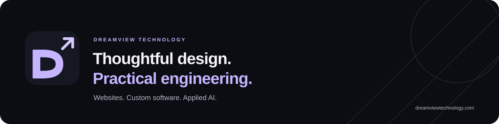

  

<h1 align="center">Dreamview Technology</h1>

<strong>Thoughtful design. Practical engineering.</strong> Digital experiences. Connected software. Human-guided AI.

  <a href="https://dreamviewtechnology.com/">Website</a> ·
  <a href="https://dreamviewtechnology.com/solutions/">AI solutions</a> ·
  <a href="https://dreamviewtechnology.com/work/">Selected work</a> ·
  <a href="https://dreamviewtechnology.com/contact/"><strong>Discuss your project ↗</strong></a>

## From a business idea to a useful system

**Dreamview Technology builds business websites, custom software and applied AI solutions around the way people work.** We connect clear interfaces with data, tools and review processes so the result has a practical place in everyday operations.

Dreamview is an **India-registered, founder-led business**, founded and led by **[Chintan Patel](https://github.com/chintan-02)**, Applied AI and Full-Stack Systems Engineer. Clients work directly with the builder from the first conversation through delivery and handover. Remote international projects are planned around scope, time-zone overlap and operating requirements.

## What we help businesses build

| Service | What it makes possible |
| --- | --- |
| **[Digital experiences](https://dreamviewtechnology.com/services/websites/)** | Present your business clearly, help customers explore your offer and create a useful path to an enquiry or purchase. |
| **[Connected software](https://dreamviewtechnology.com/services/custom-software/)** | Bring applications, data and operational tasks together through dashboards, APIs, integrations and owner workflows. |
| **[Human-guided AI](https://dreamviewtechnology.com/solutions/)** | Find approved information, process documents, prepare drafts and assist with defined tasks while keeping appropriate review in the workflow. |

Typical starting points include repeated document searches, manual data entry, disconnected tools, inconsistent AI prototypes and websites that no longer represent the business well.

## AI connected to the task

We assess the data, user journey and acceptance criteria before selecting the model or architecture.

| Capability | Focus |
| --- | --- |
| **Knowledge assistants & RAG** | Approved knowledge, retrieval, source context and missing-evidence handling |
| **Document intelligence** | Extraction, validation, exceptions and reviewed records |
| **AI agents & automation** | Defined tasks, approved tools, permissions and human approval |
| **AI evaluation & reliability** | Representative tests, failure analysis, latency, cost and regression checks |
| **Generative AI applications** | Drafting, summarization and structured assistance within a product |
| **MCP & tool integration** | Explicit tool contracts, access boundaries and integration assessment |
| **Machine learning & prediction** | Data quality, baselines, suitable metrics and operating feedback |
| **Multimodal workflows** | Agreed document, image or audio inputs with reviewable context |
| **Model customization & fine-tuning** | Evidence-led adaptation when simpler approaches leave a measured gap |

These are areas for scoped discovery and delivery. MCP, multimodal systems and fine-tuning are assessed through a specific feasibility study or pilot; the list does not imply completed enterprise deployments in every area.

[Explore the solutions and workflow examples ↗](https://dreamviewtechnology.com/solutions/)

## Selected client delivery

### Hina’s Collection

A handmade-brand ecommerce experience connecting the customer storefront with an owner studio for catalogue, categories, product images, stock and order operations. The checkout includes direct UPI instructions, with receipt verification handled by the owner.

[Read the case study ↗](https://dreamviewtechnology.com/work/hinas-collection/)

### Meet Sound & Events / DJ Meet

A photography-led service website with event galleries, service pages, filtering and a keyboard-aware lightbox. A reviewable WhatsApp enquiry draft helps customers begin a booking conversation; the business confirms the booking.

[Read the case study ↗](https://dreamviewtechnology.com/work/dj-meet/)

Client code remains private. Client assets retain their ownership, and business-impact metrics are shared only when measured and approved.

## Engineering behind the business

Chintan's independent projects demonstrate the engineering approach behind Dreamview. They are separate from client contracts.

| Project | Engineering focus |
| --- | --- |
| **[RegImpact AI](https://github.com/chintan-02/regimpact-ai)** | Evidence-linked retrieval, document lineage, analyst review, asynchronous processing and Azure deployment evidence. Verified staging release; hosting may be paused. Not production-approved or legal advice. |
| **[TriageAI / SympDirect](https://github.com/chintan-02/triageai-esi-care-routing)** | Evaluated ML inference, reviewable extraction, explicit safety escalation, audit history and reporting. Educational decision support; not clinically validated. |

Depending on the project, this work brings together **Python, FastAPI, React/Next.js, TypeScript, PostgreSQL, retrieval/vector search, ML, Docker, CI/CD and cloud delivery**. Technology follows the requirements; each project defines its own stack and responsibilities.

[Explore work and technical evidence ↗](https://dreamviewtechnology.com/work/)

## How we work

**01 / Discover** — Understand the people, current workflow, available data and desired outcome.

**02 / Define** — Agree the scope, architecture, dependencies, milestones and acceptance criteria.

**03 / Build** — Review working versions, test the important journeys and evaluate AI behavior where applicable.

**04 / Deliver** — Verify the release, document configuration and ownership, and complete the agreed handover.

Projects can begin with discovery, a focused pilot or a defined build. Ongoing care is scoped separately. Source access, accounts, data handling, third-party costs and support expectations are agreed before delivery.

[Engagement options](https://dreamviewtechnology.com/engagements/) · [Delivery, data and ownership](https://dreamviewtechnology.com/delivery-and-data/)

## Start with what needs to improve

Tell us who uses the process, what is difficult today and what a useful result would look like. Include your country/time zone and any timing or budget constraints. Share confidential records through an agreed channel.

**[Discuss your project ↗](https://dreamviewtechnology.com/contact/)** · **[Email Chintan](mailto:chintanpatel5568@gmail.com)**

[Business resources](https://dreamviewtechnology.com/resources/) · [Founder portfolio](https://chintan-patel-ai.netlify.app/) · [LinkedIn](https://www.linkedin.com/in/chintan-patel-ai/)

---

<strong>Dreamview Technology</strong> Thoughtful design. Practical engineering. <a href="https://dreamviewtechnology.com/privacy/">Privacy</a> · <a href="https://dreamviewtechnology.com/security/">Website security</a>

