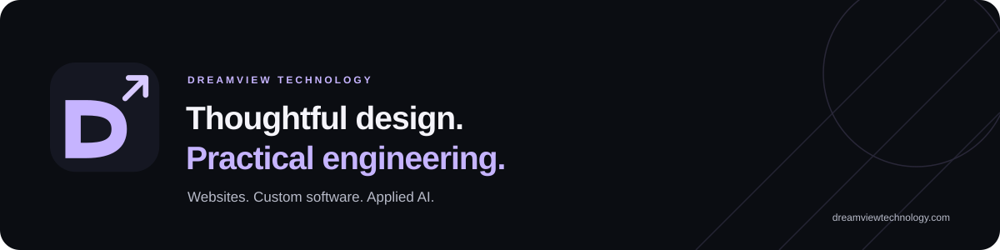

  

  <strong>From a clearer online presence to a workflow that works better.</strong> 
  Founder-led · India-registered · Built around your business

  <a href="https://dreamviewtechnology.com/"><strong>Visit our website</strong></a> &nbsp;·&nbsp;
  <a href="https://dreamviewtechnology.com/work/">Explore our work</a> &nbsp;·&nbsp;
  <a href="https://dreamviewtechnology.com/contact/"><strong>Discuss your project ↗</strong></a>

---

## Technology that follows the work

Dreamview Technology builds business websites, custom applications and practical AI workflows. Work directly with **[Chintan Patel](https://github.com/chintan-02)**, founder and AI / full-stack engineer, from the first conversation through implementation and handover.

We start with the problem, the people using the system and a clear definition of what needs to work.

## What we build

| Service | A useful starting point |
| :--- | :--- |
| **[Business websites ↗](https://dreamviewtechnology.com/services/websites/)** | Responsive service pages, galleries and clear enquiry journeys that help visitors understand your offer and take the next step. |
| **[Custom software ↗](https://dreamviewtechnology.com/services/custom-software/)** | Web applications, Python APIs, internal dashboards and integrations shaped around a specific workflow. |
| **[Applied AI & automation ↗](https://dreamviewtechnology.com/services/applied-ai/)** | Document search, evidence-linked answers and bounded automation, with evaluation, review and operating costs considered from the start. |

Explore our approach for **[events and creative businesses](https://dreamviewtechnology.com/industries/events/)**, **[service businesses](https://dreamviewtechnology.com/industries/service-businesses/)** and **[startups and small teams](https://dreamviewtechnology.com/industries/startups/)**.

## Work with context

### Client delivery · Meet Sound & Events / DJ Meet

A website built from scratch by Dreamview Technology, bringing DJ performances, sound and lighting services, event photography and a WhatsApp enquiry-draft journey into one experience.

**[Read the approved client case study ↗](https://dreamviewtechnology.com/work/dj-meet/)**

### Client delivery · Hina’s Collection

A handmade jewellery storefront connected to catalogue, categories, stock and owner order operations. Direct UPI payments use owner receipt verification; automatic gateway verification is deferred.

**[Explore the client storefront ↗](https://hinascollection.netlify.app/)** · **[Case study ↗](https://dreamviewtechnology.com/work/hinas-collection/)**

### Founder engineering · Independent projects

These projects demonstrate Chintan’s engineering experience. They are separate from Dreamview client contracts.

| Project | Engineering focus |
| :--- | :--- |
| **[TriageAI / SympDirect](https://dreamviewtechnology.com/work/triageai/)** | A live educational demo connecting structured intake, LightGBM inference, safety-rule escalation, clinician review and reporting. [Live demo ↗](https://triageai-chintan-staging.netlify.app/) **Not a validated clinical deployment.** [Source ↗](https://github.com/chintan-02/triageai-esi-care-routing) |
| **[RegImpact AI](https://dreamviewtechnology.com/work/regimpact-ai/)** | A document-intelligence system connecting regulatory changes, hybrid retrieval and authorized impact review. v0.5.0 verified in Azure staging; staging is intentionally ephemeral, with no always-on demo. **Not a legal-advice service.** [Source ↗](https://github.com/chintan-02/regimpact-ai) |

## How we work

**Understand → Scope → Build & review → Handover**

- **Understand the workflow:** clarify the users, current friction, content and data.
- **Agree on a focused scope:** define deliverables, constraints and acceptance checks.
- **Review working software:** test useful paths, important failures and integration boundaries.
- **Prepare ownership and handover:** document setup, recurring services and maintenance responsibilities.

For AI work, compare against a simpler baseline and evaluate evidence quality, errors, latency and cost. Human review belongs wherever the consequences require it.

**Engineering toolkit:** Python · FastAPI · PostgreSQL · React · TypeScript · Docker · GitHub Actions  
Tools are selected for the project; a larger stack is not the objective.

## Start with a useful conversation

Tell us what you want to improve, who it is for and any timing or constraints. Keep initial enquiries free of credentials and confidential records.

**[Discuss your project ↗](https://dreamviewtechnology.com/contact/)** &nbsp;·&nbsp;
**[Email Chintan](mailto:chintanpatel5568@gmail.com)**

Planning first? Explore our **[project brief guide](https://dreamviewtechnology.com/resources/project-brief/)** and **[AI pilot planning guide](https://dreamviewtechnology.com/resources/ai-pilot-planning/)**.

---

  <strong>Dreamview Technology</strong> 
  Founded and led by <a href="https://github.com/chintan-02">Chintan Patel</a> 
  <a href="https://dreamviewtechnology.com/">Business website</a> ·
  <a href="https://chintan-patel-ai.netlify.app/">Founder’s personal portfolio</a> ·
  <a href="https://www.linkedin.com/in/chintan-patel-ai/">LinkedIn</a> 
  <a href="https://dreamviewtechnology.com/privacy/">Privacy</a> ·
  <a href="https://dreamviewtechnology.com/security/">Website security</a>

